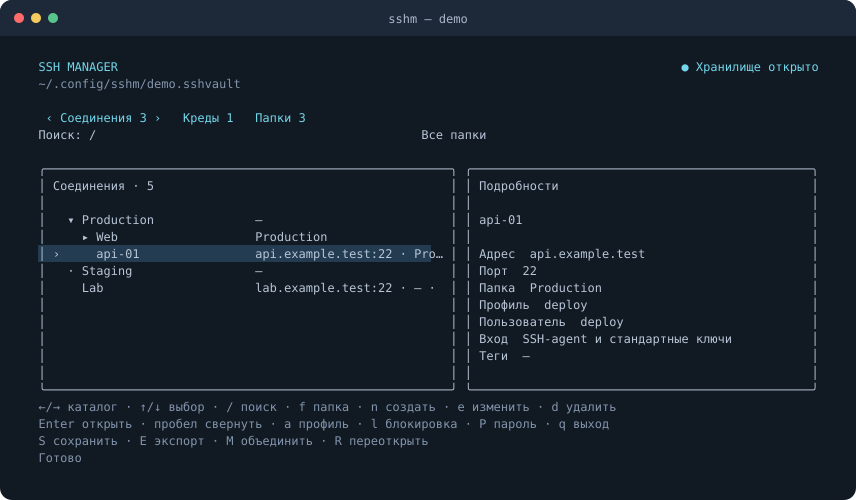

# tui-ssh-manager

[](https://github.com/torquemada163/tui-ssh-manager/actions/workflows/ci.yml)
[](https://github.com/torquemada163/tui-ssh-manager/releases/latest)
[](go.mod)
[](LICENSE)

Менеджер SSH-соединений для терминала: адреса серверов, папки и профили аутентификации в одном зашифрованном файле. При подключении системный OpenSSH получает управление текущим терминалом; после выхода с сервера возвращается список соединений. Для параллельных подключений запускайте менеджер в отдельных окнах или вкладках.



[Скачать релиз](https://github.com/torquemada163/tui-ssh-manager/releases) · [Что нового](CHANGELOG.md)

## Установка

Готовые сборки доступны в разделе **Assets** на странице [релиза](https://github.com/torquemada163/tui-ssh-manager/releases). Выберите архив для своей системы и архитектуры:

| Система | Архитектура | Окончание имени архива |
| --- | --- | --- |
| macOS, Apple Silicon | arm64 | `darwin_arm64.tar.gz` |
| macOS, Intel | amd64 | `darwin_amd64.tar.gz` |
| Linux, ARM64 | arm64 | `linux_arm64.tar.gz` |
| Linux, x86-64 | amd64 | `linux_amd64.tar.gz` |

Скачайте также `checksums.txt` в ту же папку. Перед распаковкой проверьте архив:

```sh
# macOS
shasum -a 256 --check --ignore-missing checksums.txt
# Linux
sha256sum --check --ignore-missing checksums.txt
```

Распакуйте выбранный `.tar.gz`. Из папки с распакованным бинарником:

```sh
mkdir -p "$HOME/.local/bin"
install -m 755 sshm "$HOME/.local/bin/sshm"
"$HOME/.local/bin/sshm" -version
"$HOME/.local/bin/sshm"
```

Если `~/.local/bin` находится в `PATH`, приложение можно запускать командой `sshm`. Для работы нужен системный OpenSSH (`ssh` в `PATH`). Сборки macOS пока без подписи и нотариализации Apple. Работа на Linux ещё не проверена; доступны кросс-сборки.

## Сборка из исходников

Для работы нужны macOS или Linux, OpenSSH (`ssh` в PATH) и терминал с поддержкой ANSI и UTF-8. Для сборки из исходников нужны Go 1.24 или новее и `make`:

```sh
make build
./bin/sshm
```

При первом запуске задайте главный пароль длиной не менее 10 символов. Хранилище создаётся в `~/.config/sshm/connections.sshvault`; текущий путь виден вверху экрана. Другой файл можно указать так:

```sh
./bin/sshm -vault "$HOME/Cloud/SSH/connections.sshvault"
```

Хранилище блокируется после пяти минут бездействия, в том числе при возврате из долгой SSH-сессии. Параметр `-lock-after 15m` меняет таймаут, `-lock-after 0` отключает его. Справка доступна через `./bin/sshm -help`.

## Первое подключение

1. Нажмите `→`, чтобы открыть «Креды», затем `n`. Укажите пользователя, выберите тип аутентификации стрелками `←` / `→` и заполните нужные поля. Сохраните через `Ctrl+S`.
2. Вернитесь к соединениям через `←` и нажмите `n`. Введите адрес сервера; порт по умолчанию — `22`.
3. В поле «Креды» нажмите `Enter`, отметьте профиль пробелом, подтвердите через `Enter` и сохраните соединение через `Ctrl+S`.
4. Нажмите `Enter` на соединении, чтобы подключиться.

Имена профиля и соединения можно оставить пустыми — они сформируются автоматически. Папки и профили выбираются из списков. Одному соединению можно назначить несколько профилей и выбрать профиль по умолчанию; клавиша `a` позволяет выбрать профиль перед подключением. Пустой список профилей означает наследование от ближайшей родительской папки с назначенными профилями.

На вкладках «Соединения» и «Папки» список иерархический: сначала идут папки по алфавиту, затем соединения. Изначально виден верхний уровень; соединения без папки находятся под корневыми папками. `▸` означает свёрнутую папку с содержимым, `▾` — развёрнутую. `Enter` или пробел разворачивает и сворачивает папку; `e` редактирует выбранный объект. Поиск показывает совпадения вместе с родительскими папками.

## Аутентификация

| Тип | Что указать |
| --- | --- |
| SSH-agent и стандартные ключи | Пользователя; используются текущий агент и стандартные ключи в `~/.ssh`. |
| Локальный ключ | Пользователя и файл ключа, при необходимости — парольную фразу. |
| Ключ в хранилище | Пользователя и импортированный приватный ключ, при необходимости — парольную фразу. |
| Пароль | Пользователя и пароль. |

`Enter` в поле ключа открывает выбор файла или источника импорта. Браузер показывает скрытые файлы; `←` / `Backspace` поднимает на уровень выше. Для встроенного ключа доступна вставка средствами терминала; `Ctrl+V` читает системный буфер, если он доступен. Содержимое ключа на экране скрыто.

Локальные ключи в домашней папке сохраняются с путём `~/…`: на другом компьютере файл должен находиться по тому же пути. OTP вводится при подключении. Адрес, порт и пользователь берутся из каталога; `~/.ssh/config` не читается. Новый ключ сервера требует подтверждения, изменённый известный ключ блокирует подключение.

### Ключ в хранилище

Это копия вашего приватного SSH-ключа, сохранённая внутри `.sshvault` вместе с профилем подключения. Для импорта выберите файл, например `id_ed25519`, или вставьте его содержимое; файл `id_ed25519.pub` — публичная часть ключа, которую добавляют на сервер для разрешения входа. Копия шифруется вместе со всем хранилищем и становится доступна после ввода главного пароля. Если сам ключ защищён парольной фразой, укажите её в профиле при импорте.

После сохранения изменения исходного файла на диске на эту копию не влияют. При переносе хранилища на другой компьютер ключ переносится вместе с ним, поэтому отдельно копировать исходный файл не потребуется. Во время подключения приложение предоставляет ключ системному SSH через временный агент в памяти, который прекращает работу после сессии.

## Основные клавиши

| Клавиша | Действие |
| --- | --- |
| `←` / `→`, `Tab` / `Shift+Tab` | Переключить каталог |
| `↑` / `↓`, `j` / `k` | Выбрать объект |
| `/`, `f` | Поиск, фильтр папки |
| `n` / `e` / `d` | Создать / изменить / удалить |
| `Enter`, пробел | Открыть/свернуть папку; `Enter` на соединении — подключиться |
| `a` | Выбрать профиль подключения |
| `l`, `P` | Заблокировать хранилище, сменить главный пароль |
| `S`, `E`, `M`, `R` | Сохранить, экспортировать, объединить копию, переоткрыть |
| `q` / `Ctrl+C` | Выйти |

В формах `Tab` / `↑` / `↓` переключают поля, `Ctrl+S` сохраняет, `Esc` отменяет. В списках назначения пробел отмечает профиль, `Enter` применяет выбор. Во время SSH клавиши принадлежат удалённой сессии.

## Хранилище и синхронизация

Для синхронизации разместите `.sshvault` в папке облачного клиента и откройте его на другом устройстве с тем же главным паролем. Весь файл зашифрован, включая адреса, названия и ключи. Главный пароль восстановить нельзя.

Независимые изменения объединяются при сохранении; при конфликте приложение предлагает выбрать версию объекта. Отдельную конфликтную копию можно объединить через `M`. При таком объединении удаления автоматически не распространяются.

Предыдущие версии сохраняются рядом с файлом как `connections.sshvault.backup-*`. Их можно открыть через `-vault`; они используют пароль, действовавший при создании, и автоматически не удаляются. Перед работой с одним хранилищем на разных устройствах дождитесь завершения облачной синхронизации.

## Лицензия и условия использования

Утилита распространяется по лицензии [MIT](LICENSE) и предоставляется «как есть», без каких-либо явных или подразумеваемых гарантий, включая гарантии работоспособности, сохранности данных и пригодности для конкретных задач. Использование — на ваш риск. В пределах, допускаемых применимым законодательством, авторы и правообладатели не несут ответственности за убытки, потерю данных или иные последствия использования утилиты.

Поддержка, обновления и исправление ошибок не гарантируются. Наличие раздела Issues не предполагает обязательств по рассмотрению обращений, ответам на них или реализации предложений.
